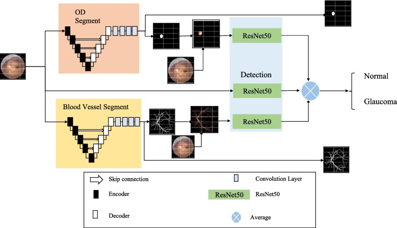

# MultiGlaucNet: Glaucoma Detection with Vanilla & Hybrid DUNet Segmentation and Three-Branch ResNet50

[](https://www.python.org/downloads/)
[](https://pytorch.org/)
[](https://opensource.org/licenses/MIT)

Repositori ini memuat implementasi *deep learning* untuk deteksi glaukoma otomatis berbasis segmentasi multi-tugas (*multi-task segmentation-guided glaucoma detection*) menggunakan citra fundus retina pada dataset **SMDG-19** (*Standardized Multi-Channel Dataset for Glaucoma*).

Arsitektur ini mengintegrasikan **Deformable U-Net (DUNet)** untuk segmentasi Optic Disc (OD) dan pembuluh darah retina, yang kemudian memandu modul deteksi **Three-Branch ResNet50** dengan strategi *Two-Stage Decoupled Training*.

---

## 📌 Gambaran Umum Arsitektur

Secara makro, sistem bekerja dalam tiga tahapan utama:
1. **Segmentasi Anatomi**: Dua jaringan segmentasi memetakan probabilitas batas *Optic Disc* ($M_{OD}$) dan jaringan pembuluh darah ($M_{vessel}$).
2. **Masking Kontekstual**: Masker biner dikalikan secara piksel demi piksel dengan citra asli fundus ($I_{OD} = I_{orig} \odot M_{OD}$ dan $I_{vessel} = I_{orig} \odot M_{vessel}$) untuk mengisolasi area patologis.
3. **Deteksi Glaukoma Tiga Cabang**: Tiga cabang ResNet50 mengekstraksi fitur dari $I_{orig}$ (Konteks Global), $I_{OD}$ (Konteks Lokal OD), dan $I_{vessel}$ (Konteks Lokal Pembuluh Darah), lalu difusikan melalui *Average Feature Pooling* sebelum klasifikasi biner (*Normal vs Glaucoma*).



---

## 🔬 Varian Model Segmentasi

Penelitian ini membandingkan dua varian model segmentasi untuk menguji pengaruh arsitektur terhadap performa deteksi glaukoma:

| Fitur / Komponen | **Varian Vanilla (Baseline)** | **Varian Hybrid (Proposed Novelty)** |
| :--- | :--- | :--- |
| **Dasar Arsitektur** | Murni mengikuti DUNet (*Jin et al., 2019*) | Penggabungan DCNv2 ke dalam ResNet + Multi-GlaucNet |
| **Encoder** | U-Net 5-level dengan DCNv2 pada `down1` & `down2` | Deformable ResNet Backbone (`DeformableBottleneck` blocks) |
| **Decoder** | Bilinear Upsampling + DCNv2 pada `up3` & `up4` | **5-Stage PixelShuffle Sub-Pixel Reconstruction** |
| **Mekanisme Perhatian** | Tanpa layer attention | **Channel Attention Mechanism (CAM / SE-Block)** |
| **Input-Output Skip** | Concatenation citra asli (`torch.cat([inp, x])`) | Skip connection multi-skala pada setiap tahap decoder |
| **Resolusi Luaran** | $512 \times 512 \times 1$ | $512 \times 512 \times 1$ |

Spesifikasi XML lengkap:
- [MultiGlaucNet_DUNet_Vanilla_Architecture.xml](MultiGlaucNet_DUNet_Vanilla_Architecture.xml)
- [MultiGlaucNet_DUNet_Hybrid_Architecture.xml](MultiGlaucNet_DUNet_Hybrid_Architecture.xml)

---

## ⚖️ Strategi Pelatihan & Eksperimen Ablasi Focal Loss

### 1. Two-Stage Decoupled Training
Operasi binarisasi masker ($M = \mathbb{I}(P > 0.5)$) adalah fungsi tangga non-diferensiabel yang memutus aliran gradien balik dari modul deteksi ke modul segmentasi. Oleh karena itu, diterapkan skema dua tahap:
- **Tahap 1 (Stage 1)**: Modul segmentasi dilatih terlebih dahulu hingga konvergen menggunakan kombinasi *Dice Loss* dan *BCE Loss*.
- **Tahap 2 (Stage 2)**: Bobot modul segmentasi **dibekukan (*frozen*)**, lalu masker biner digunakan untuk melatih *Three-Branch ResNet50*.

### 2. Ablation Study Fungsi Loss Deteksi
Untuk menguji pengaruh penekanan sampel mudah pada data SMDG-19, modul deteksi dievaluasi dalam 3 skenario:

| Skenario | Konfigurasi Loss | Deskripsi & Tujuan |
| :---: | :--- | :--- |
| **Skenario 1 (Baseline)** | Cross-Entropy Standar ($\gamma = 0.0, \alpha = 1.0$) | Evaluasi dasar tanpa penanganan ketidakseimbangan kelas. |
| **Skenario 2 (Literatur Standar)** | Focal Loss ($\gamma = 2.0, \alpha = \frac{N_{\text{normal}}}{N_{\text{glaukoma}}}$) | Menyesuaikan pembobotan kelas secara empiris dari distribusi dataset SMDG-19. |
| **Skenario 3 (Ekstrem Paper Acuan)** | Focal Loss MultiGlaucNet ($\gamma = 10.0, \alpha = 3.0$) | Menguji apakah parameter ekstrem paper acuan cocok untuk dataset SMDG-19. |

---

## 📁 Struktur Direktori Proyek

```text
biomedik/
├── configs/
│   └── config.yaml                     # Konfigurasi hyperparameter dan paths
├── data/
│   ├── raw/smdg-19/                    # Direktori dataset citra fundus & CSV metadata
│   └── processed/                      # Cache hasil pre-processing
├── src/
│   ├── dataset/
│   │   ├── downloader.py               # Downloader otomatis (Kaggle API / synthetic generator)
│   │   ├── preprocessor.py             # ROI crop, CLAHE (L-channel), dan Resize 512x512
│   │   └── smdg_dataset.py             # PyTorch Dataset & Stratified DataLoader
│   ├── models/
│   │   ├── vanilla_dunet.py            # Modul segmentasi DUNet Vanilla (Jin et al.)
│   │   ├── hybrid_dunet.py             # Modul segmentasi DUNet Hybrid (DCN ResNet + PixelShuffle + CAM)
│   │   └── detection_head.py           # Three-Branch ResNet50 Detector
│   ├── losses/
│   │   ├── dice_loss.py                # DiceLoss & BCEDiceLoss
│   │   └── focal_loss.py               # FocalLoss dengan 3 skenario ablasi
│   ├── training/
│   │   ├── train_segmentation.py       # Skrip pelatihan Tahap 1 (Segmentasi)
│   │   └── train_detection.py          # Skrip pelatihan Tahap 2 (Deteksi & Ablation Study)
│   └── utils/
│       ├── metrics.py                  # Metrik evaluasi (Dice, IoU, AUC-ROC, Sens, Spec)
│       └── visualizer.py               # Visualizer multi-panel hasil segmentasi & deteksi
├── checkpoints/                        # Direktori penyimpanan bobot model (*.pth)
├── results/                            # Hasil visualisasi dan log riwayat pelatihan
├── MultiGlaucNet_DUNet_Vanilla_Architecture.xml
├── MultiGlaucNet_DUNet_Hybrid_Architecture.xml
├── arsitektur.jpg
├── requirements.txt
└── README.md
```

---

## 🛠️ Instalasi & Persiapan Lingkungan

1. **Clone repositori**:
   ```bash
   git clone https://github.com/<USERNAME>/MultiGlaucNet-DUNet.git
   cd MultiGlaucNet-DUNet
   ```

2. **Buat virtual environment (disarankan)**:
   ```bash
   python3 -m venv venv
   source venv/bin/activate  # Di Linux/macOS
   # venv\Scripts\activate   # Di Windows
   ```

3. **Install dependensi**:
   ```bash
   pip install -r requirements.txt
   ```

---

## 📥 Panduan Unduh Dataset (SMDG-19)

Dataset **SMDG-19** (*Standardized Multi-Channel Dataset for Glaucoma*) tersedia di Kaggle:
👉 [Kaggle - Multichannel Glaucoma Benchmark Dataset](https://www.kaggle.com/datasets/deathtrooper/multichannel-glaucoma-benchmark-dataset)

Anda dapat mengunduhnya dengan salah satu cara berikut:

### Opsi A: Otomatis melalui Skrip Downloader (Kaggle API)
Pastikan Anda memiliki file `~/.kaggle/kaggle.json`, atau masukkan kredensial langsung:
```bash
python3 -m src.dataset.downloader --kaggle-user <KAGGLE_USERNAME> --kaggle-key <KAGGLE_KEY>
```

### Opsi B: Unduh Manual dari Web
1. Unduh file `.zip` langsung dari halaman Kaggle di atas.
2. Letakkan file ZIP di folder `data/raw/smdg-19/`.
3. Jalankan skrip downloader untuk mengekstrak dan memverifikasi struktur file secara otomatis:
   ```bash
   python3 -m src.dataset.downloader
   ```

### Opsi C: Mode Sintetis (Uji Coba Cepat Tanpa Unduh 3GB)
Untuk memverifikasi fungsionalitas seluruh alur program tanpa menunggu unduhan:
```bash
python3 -m src.dataset.downloader --generate-synthetic --num-samples 24
```

---

## 🚀 Panduan Eksekusi Langkah Demi Langkah (TODOs)

Berikut adalah alur eksekusi langkah demi langkah untuk menjalankan eksperimen penelitian:

### ✅ Langkah 1: Pelatihan Tahap 1 — Modul Segmentasi OD & Vessel
Latih model segmentasi hingga konvergen (*checkpoint* terbaik akan disimpan otomatis di `checkpoints/segmentation/`):

```bash
# 1A. Melatih Vanilla DUNet untuk Optic Disc (OD) dan Vessel:
python3 src/training/train_segmentation.py --variant vanilla --target both --epochs 25 --batch-size 4

# 1B. Melatih Hybrid DUNet untuk Optic Disc (OD) dan Vessel:
python3 src/training/train_segmentation.py --variant hybrid --target both --epochs 25 --batch-size 4
```

### ✅ Langkah 2: Pelatihan Tahap 2 — Deteksi Glaukoma & Ablation Study
Gunakan masker yang dihasilkan oleh model segmentasi beku untuk melatih detektor *Three-Branch ResNet50* pada 3 skenario loss:

```bash
# 2A. Skenario 1 (Baseline): Cross-Entropy Standar (gamma=0, alpha=1.0)
python3 src/training/train_detection.py --variant vanilla --scenario 1 --epochs 20 --batch-size 4

# 2B. Skenario 2 (Standar Literatur): Focal Loss (gamma=2.0, alpha dihitung otomatis dari rasio dataset)
python3 src/training/train_detection.py --variant vanilla --scenario 2 --epochs 20 --batch-size 4

# 2C. Skenario 3 (Ekstrem Paper Acuan): Focal Loss MultiGlaucNet (gamma=10.0, alpha=3.0)
python3 src/training/train_detection.py --variant vanilla --scenario 3 --epochs 20 --batch-size 4

# 2D. Uji Varian Hybrid dengan Skenario Loss Terbaik (misal Skenario 2):
python3 src/training/train_detection.py --variant hybrid --scenario 2 --epochs 20 --batch-size 4
```

---

## 📊 Metrik Evaluasi

Sesuai spesifikasi `Phase 5`, evaluasi performa model mencakup:
* **Tugas Segmentasi**: *Dice Coefficient*, *IoU (Jaccard Index)*, *Sensitivity*, *Specificity*, dan *Accuracy*.
* **Tugas Deteksi Glaukoma**: *Accuracy*, *Sensitivity (Recall)*, *Specificity*, *Precision*, *AUC-ROC*, dan *Confusion Matrix*.

---

## 🙏 Kredit & Sitasi Akademik (Acknowledgements)

Proyek ini dibangun berdasarkan dan mengintegrasikan kontribusi dari karya-karya ilmiah berikut:

1. **Arsitektur DUNet (Deformable U-Net)**:
   > **DUNet: A deformable network for retinal vessel segmentation**  
   > *Qiangguo Jin, Zhaopeng Meng, Tuan D. Pham, Qi Chen, Leyi Wei, Ran Su*  
   > Knowledge-Based Systems, 2019. DOI: [10.1016/j.knosys.2019.04.025](https://doi.org/10.1016/j.knosys.2019.04.025)  
   > Repositori Referensi: [RanSuLab/DUNet-retinal-vessel-detection](https://github.com/RanSuLab/DUNet-retinal-vessel-detection)

2. **Arsitektur Multi-GlaucNet**:
   > **Multi-GlaucNet: A multi-task model for optic disc segmentation, blood vessel segmentation and glaucoma detection**  
   > *Haoren Xiong, Fei Long, Mohammad S. Alam, Jun Sang*  
   > Biomedical Signal Processing and Control, Vol. 99, 106850, 2025. DOI: [10.1016/j.bspc.2024.106850](https://doi.org/10.1016/j.bspc.2024.106850)

3. **Dataset SMDG-19**:
   > **Standardized Multi-Channel Dataset for Glaucoma (SMDG-19)**  
   > *TheBeastCoding / deathtrooper*  
   > Sumber Dataset: [Kaggle Benchmark Dataset](https://www.kaggle.com/datasets/deathtrooper/multichannel-glaucoma-benchmark-dataset) & [GitHub Catalog](https://github.com/TheBeastCoding/standardized-multichannel-dataset-glaucoma)

---

## 📄 Lisensi
Proyek ini didistribusikan di bawah lisensi MIT. Silakan lihat file `LICENSE` untuk informasi lebih lanjut.
